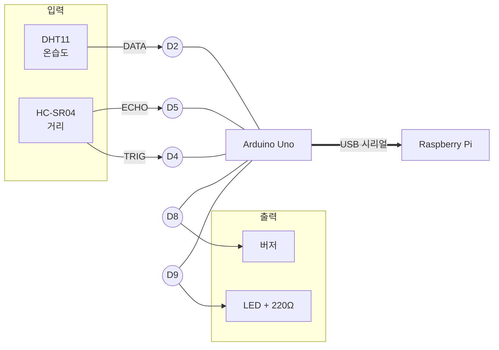

# 🪞 Smart Mirror — 임베디드 시스템 프로젝트

아침에 거울 앞에 서면 **날씨 · 일정 · 코디 추천 · 우산 알림**을 한 화면에서 보여주는 스마트미러.
Raspberry Pi(메인 서버/화면) + Arduino(센서 노드) 구조입니다.

## 기능

| #   | 기능                                                                         | 구현 위치                                               |
| --- | ---------------------------------------------------------------------------- | ------------------------------------------------------- |
| 1   | 날씨(외부) + 실내 온습도 기반 **코디 추천**                                  | `services/weather.py`, `services/outfit.py`, `arduino/` |
| 1   | 카메라로 **가상 시착** (MediaPipe + OpenCV)                                  | `services/tryon.py`, `services/wardrobe.py`             |
| 2   | 캘린더(.ics) + 할 일                                                         | `services/calendar_service.py`, `routers/todos.py`      |
| 3   | **우산 알림** (화면 배너 + 아두이노 버저/LED)                                | `services/alerts.py`, `.ino`                            |
| 4   | **LLM 비서** (아침 브리핑 + 폰에서 대화)                                     | `services/llm.py`                                       |
| 5   | 현재 시간/날짜                                                               | `frontend/js/mirror.js`                                 |
| +   | 미세먼지 알림, 일교차 알림, 실내 불쾌지수, 초음파로 사람 감지 시 화면 ON/OFF | 각 서비스                                               |

## 구조

```
smart-mirror/
├── app/                      # 백엔드 (FastAPI)
│   ├── main.py               #   서버 진입점
│   ├── config.py             #   .env 설정
│   ├── database.py           #   SQLite (옷장, 할 일)
│   ├── routers/              #   URL 정의 (얇게 유지)
│   └── services/             #   실제 로직 (기능별 1파일)
├── frontend/                 # 미러 화면(index.html) + 폰 관리 페이지(admin.html)
├── arduino/                  # 센서 스케치 (DHT11, HC-SR04, 버저, LED)
├── tests/                    # pytest
├── scripts/  deploy/         # 실행/키오스크/systemd
└── data/                     # 옷 사진, DB (git 제외)
```

```
 DHT11 ─┐                        ┌─ Open-Meteo (날씨/대기질)
 HC-SR04┼─ Arduino ══USB══ Raspberry Pi ── 구글 캘린더(.ics)
 버저/LED┘   (JSON 한 줄)    FastAPI 서버 ── Claude API (LLM)
                                │   └─ 카메라 → MediaPipe → 옷 합성
                       Chromium 전체화면(미러) / 폰 브라우저(관리)
```

## 하드웨어 배선

부품: Arduino Uno, DHT11, HC-SR04, 버저, LED(+220Ω 저항), 브레드보드



| 부품    | 부품 핀           | Arduino        | 비고                                                           |
| ------- | ----------------- | -------------- | -------------------------------------------------------------- |
| DHT11   | VCC / GND         | 5V / GND       |                                                                |
|         | DATA              | D2             | 4핀 낱개 제품은 DATA–VCC 사이 10kΩ 풀업 필요 (3핀 모듈은 내장) |
| HC-SR04 | VCC / GND         | 5V / GND       |                                                                |
|         | TRIG              | D4             |                                                                |
|         | ECHO              | D5             | Uno 는 5V 로직이라 직결 가능 (3.3V 보드는 분압 필요)           |
| 버저    | (+) / (−)         | D8 / GND       | 능동 버저면 스케치의 `BUZZER_PASSIVE` 를 0 으로                |
| LED     | 애노드(긴 다리)   | D9 (220Ω 직렬) | 저항 없이 연결하면 LED/핀이 상할 수 있음                       |
|         | 캐소드(짧은 다리) | GND            |                                                                |

- **사람 감지**: HC-SR04 거리가 `PRESENCE_DISTANCE_CM`(기본 120cm) 이내면 '거울 앞에 사람 있음'. `PRESENCE_TIMEOUT_SEC`(기본 30초) 동안 감지가 없으면 화면이 꺼져 거울처럼 보임.
- **DHT11 정확도**: 온도 ±2°C, 습도 ±5%, 정수 단위. 코디 추천은 외부 날씨(체감온도)가 기준이고, 실내값은 쾌적도 안내용이라 DHT11 로 충분하다.

## 시작하기

### A. 노트북에서 (센서/카메라 없이)

```bash
python3 -m venv .venv && source .venv/bin/activate
pip install -r requirements.txt
cp .env.example .env                                      # SENSOR_MODE=mock 그대로 OK
./scripts/run_dev.sh
```

- 미러 화면: http://localhost:8000/
- 관리 페이지(옷 등록, 할 일, AI 대화): http://localhost:8000/admin.html
- API 문서: http://localhost:8000/docs

### B. 옷 누끼 / 가상 시착까지 쓰려면

```bash
pip install -r requirements-vision.txt
# .env → TRYON_ENABLED=true  (카메라 필요)
```

### C. 라즈베리파이 + 아두이노

1. 아두이노 IDE에서 `arduino/smart_mirror_sensor/smart_mirror_sensor.ino` 업로드 (라이브러리: _DHT sensor library_, _Adafruit Unified Sensor_)
2. 아두이노를 파이에 USB로 연결 → `ls /dev/ttyACM*` 로 포트 확인
3. `.env` → `SENSOR_MODE=serial`, `SERIAL_PORT=/dev/ttyACM0`
4. `sudo usermod -aG dialout $USER` 후 재로그인 (시리얼 권한)
5. 한글 폰트: `sudo apt install fonts-noto-cjk`
6. 자동 실행: `deploy/smart-mirror.service` 설치 + `scripts/start_kiosk.sh` 를 자동시작에 등록

### 구글 캘린더 연결

캘린더 설정 → **비공개 주소(iCal 형식)** 복사 → `.env` 의 `ICS_URL` 에 붙여넣기. (이 주소는 비밀번호와 같으니 절대 커밋 금지)

## 테스트

```bash
pytest
```

## 알려진 한계 (발표/보고서에 솔직하게 쓰면 좋은 부분)

- **시착은 2D 합성**: 몸 좌표에 맞춰 옷 이미지를 늘려 붙이는 방식이라 주름/팔 동작은 표현 못 함. 실제 diffusion 기반 가상 피팅은 라즈베리파이에서 불가.
- **대기질은 모델 기반 추정값**(Open-Meteo/CAMS). 정확한 측정값은 에어코리아 API(공공데이터포털)로 교체 가능.
- 관리 페이지에는 로그인이 없다. **같은 와이파이 안에서만** 사용할 것.

## 팀 협업 규칙

- `main` 에 직접 push 금지. `feature/<작업>` 브랜치 → PR → 1명 이상 확인 후 merge
- 커밋 메시지: `feat: …`, `fix: …`, `docs: …`, `test: …`
- `.env`, `data/` 는 절대 커밋하지 않기 (`.gitignore` 에 이미 포함)

## 3주 일정 (제안)

| 주차 | 목표                                                       | 완료 기준                                                     |
| ---- | ---------------------------------------------------------- | ------------------------------------------------------------- |
| 1주  | 서버 뼈대 + 날씨/시계/일정 + 아두이노 온습도 + 옷 등록     | 노트북에서 미러 화면이 실제 날씨로 뜬다, 센서값이 화면에 뜬다 |
| 2주  | 코디 추천 + 우산 알림(버저) + LLM 브리핑/대화 + 시착 PoC   | 옷 10벌 이상 등록 후 추천이 납득 가능, 비 예보 시 부저 울림   |
| 3주  | 파이 이식 + 키오스크 + 거울 제작 + 시착 다듬기 + 발표 자료 | **마감 3일 전 기능 동결**, 남은 기간은 안정화/리허설          |
